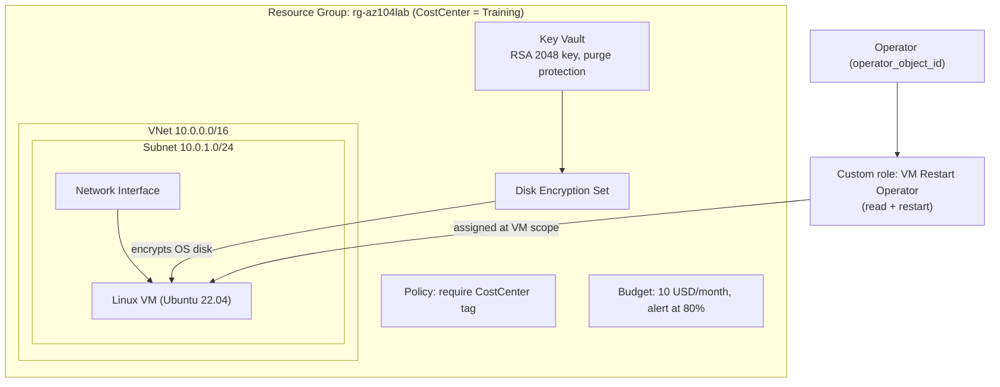

# Virtual Machines and RBAC (Azure + Terraform)

A Linux VM with a customer-managed-key encrypted disk, a custom RBAC role scoped to that one VM, a tag policy and a cost budget. Deployed and destroyed with Terraform on Azure, as practice for AZ-104 topics.

---

## What You'll Learn

- Building a network, NIC and Linux VM with Terraform
- Encrypting an OS disk with a customer-managed key (Key Vault + disk encryption set)
- Writing a custom RBAC role that allows only read and restart
- Scoping a role assignment to a single VM instead of the resource group or subscription
- Assigning an Azure Policy that requires a `CostCenter` tag
- Setting a monthly cost budget with an 80% alert
- Troubleshooting real deployment errors (SKU capacity, hypervisor generation, state file access, power state conflicts)

---

## Architecture

The lab deploys everything inside one resource group, `rg-az104lab`, tagged `CostCenter = Training`. A virtual network (`10.0.0.0/16`) holds one subnet (`10.0.1.0/24`), and a network interface in that subnet connects a Linux VM. The VM's OS disk is encrypted by a disk encryption set, which takes its key from a Key Vault. Access policies let both the deploying user and the encryption set use that key.

A custom role, "VM Restart Operator", is defined and assigned at the VM's scope, so the operator can only read and restart that VM. A policy assignment on the resource group requires a `CostCenter` tag, and a 10 USD monthly budget sends an email alert at 80%.



| Component | Purpose |
|-----------|---------|
| Key Vault + key + disk encryption set | Customer-managed encryption of the OS disk |
| Custom role "VM Restart Operator" | Least privilege: read and restart this VM only |
| Role assignment | Grants the custom role to `operator_object_id` |
| Policy assignment | Requires the `CostCenter` tag |
| Budget | Email alert at 80% of 10 USD |

**Why VM scope?** The operator can restart this VM only. They cannot touch other resources in the resource group or subscription.

---

## Prerequisites

| Requirement | Details |
|-------------|---------|
| Azure subscription | Needs VM capacity in your chosen region |
| Terraform | v1.16.6 with the `azurerm` provider (`~> 3.100`) |
| Azure CLI | Signed in with `az login` |
| SSH public key | Expected at `~/.ssh/id_rsa.pub` (create with `ssh-keygen`) |
| Object ID | Azure AD object ID of the user who gets the custom role |

---

## Step 1: Configure Variables

Set these inputs in `variables.tf` defaults or in a `terraform.tfvars` file:

```hcl
prefix             = "az104lab"
location           = "eastus"
operator_object_id = "<object ID>"
alert_email        = "<your email>"
```

The VM uses size `Standard_D2s_v4` with the Ubuntu 22.04 image sku `22_04-lts`.

> **Security note:** keep `terraform.tfvars`, `terraform.tfstate` and `.terraform/` out of git.

VM size availability varies by subscription and region. Check the portal's size picker, or run:

```powershell
az vm list-skus --location eastus --size Standard_D2 --resource-type virtualMachines --output table
```

Pick a size whose Restrictions column is empty. Match the image to the size: use `22_04-lts-gen2` for Gen 2 only sizes and `22_04-lts` for Gen 1 compatible sizes.

---

## Step 2: Deploy

```powershell
az login
terraform init
terraform fmt
terraform validate
terraform plan
terraform apply
```

The plan should report 14 resources to add.

---

## Step 3: Verify

- Portal: `vm-az104lab` shows **Running**
- VM, then **Access control (IAM)**, then **Role assignments**: the custom role is present
- Resource group, then **Policies**: `require-costcenter` is assigned
- **Cost Management**, then **Budgets**: `budget-az104lab` exists
- `terraform output` prints the resource group name, VM name, VM ID and custom role name

---

## Project Structure

```
Virtual-Machines-and-RBAC/
├── main.tf                    # Provider config and all 14 resources
├── variables.tf               # Input variable definitions
├── outputs.tf                 # Values printed after apply
├── terraform.tfvars.example   # (optional) Safe template with placeholder values
├── terraform.tfvars           # (local only) Your real values, DO NOT commit
├── .gitignore                 # Excludes state, .terraform/, tfvars
└── .terraform.lock.hcl        # Provider version lock, created by terraform init
```

Terraform also creates `terraform.tfstate` and a `.terraform/` folder locally. Neither belongs in git.

| File | Contents |
|------|----------|
| `main.tf` | `terraform` and `provider "azurerm"` blocks, one data source for the signed-in identity, and every resource in the lab |
| `variables.tf` | `prefix`, `location`, `operator_object_id`, `alert_email` |
| `outputs.tf` | `resource_group_name`, `vm_name`, `vm_id`, `custom_role_name` |

### Resources in main.tf, in build order

| # | Resource | Depends on |
|---|----------|-----------|
| 1 | `azurerm_resource_group.rg` | none |
| 2 | `azurerm_virtual_network.vnet` | resource group |
| 3 | `azurerm_subnet.subnet` | VNet |
| 4 | `azurerm_network_interface.nic` | subnet |
| 5 | `azurerm_key_vault.kv` | resource group, client config |
| 6 | `azurerm_key_vault_access_policy.me` | Key Vault |
| 7 | `azurerm_key_vault_key.key` | access policy `me` |
| 8 | `azurerm_disk_encryption_set.des` | Key Vault key |
| 9 | `azurerm_key_vault_access_policy.des` | disk encryption set |
| 10 | `azurerm_linux_virtual_machine.vm` | NIC, DES, access policy `des` |
| 11 | `azurerm_role_definition.vm_restart` | VM |
| 12 | `azurerm_role_assignment.vm_restart` | role definition |
| 13 | `azurerm_resource_group_policy_assignment.tags` | VM, key, role assignment |
| 14 | `azurerm_consumption_budget_resource_group.budget` | resource group |

### Key design choices

- **Explicit `depends_on`:** the vault key waits for the creator's access policy. The VM waits for the disk encryption set's access policy.
- **Scoped role:** the custom role's `scope` and `assignable_scopes` are both the VM's ID, so it can't be assigned anywhere else.
- **Variables for anything personal:** `operator_object_id` and `alert_email` are never hardcoded in `main.tf`.
- **Unique vault name:** the Key Vault name adds the first four characters of the subscription ID to `prefix`, since vault names are global.

---

## Troubleshooting

| Issue | Solution |
|-------|----------|
| `Invalid block definition` at a resource line | A brace was lost in a paste. Make sure the line ends with `{` and every block closes |
| `SkuNotAvailable` (409) for a B-series size | The region has no capacity for that size. Pick a size shown as available in the portal size picker, or change region |
| `cannot boot Hypervisor Generation '1'` (400) | Image and size generations don't match. Use `22_04-lts-gen2` for Gen 2 sizes, or `22_04-lts` for Gen 1 sizes |
| `Error acquiring the state lock ... Access is denied` | Check that `terraform.tfstate` is a file, not a folder, and is not locked by another program |
| `OperationNotAllowed` on `powerOff` | The VM is already deallocated. Run `az vm start`, then rerun Terraform |
| Key Vault name already used after destroy | Purge protection keeps the name for 7 days. Change `prefix` |

---

## Teardown

```powershell
terraform destroy
```

Type `yes` when prompted. If Terraform cannot read its state, remove everything directly:

```powershell
az group delete --name rg-az104lab --yes
```

To only pause the lab, deallocate the VM and start it again before running Terraform:

```powershell
az vm deallocate -g rg-az104lab -n vm-az104lab
az vm start -g rg-az104lab -n vm-az104lab
```

The Key Vault stays soft-deleted for 7 days after destroy (purge protection) at no cost. Change `prefix` if you rebuild within that window. After teardown, `az group exists --name rg-az104lab` should return `false`.
